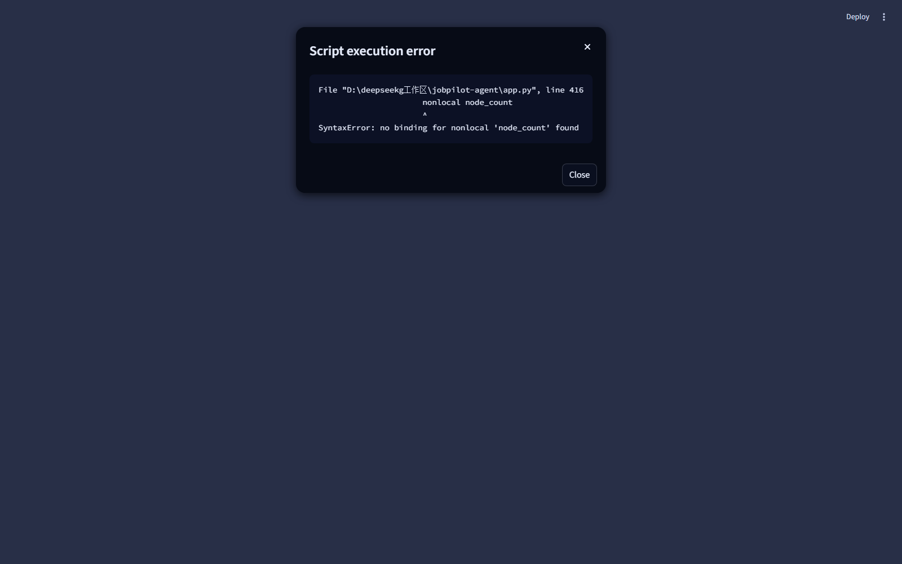

# 🧭 JobPilot-Agent

**基于 LangGraph 的多智能体秋招护航系统** —— 简历优化 → 岗位匹配 → 量化打分 → 自动投递管理，一站式秋招护航。

> 一个由 **「主管 + 四名专家 Agent」** 协作的求职助手：侦察兵全网扒岗位 → 裁缝逐条对简历 → 评估员量化打分 → 管家排投递节奏。你只需要说清楚想找什么。

    

---

## ✨ 特性

| 能力 | 说明 |
|------|------|
| 🤖 **五角色多智能体** | 主管（Supervisor）状态驱动调度 + 侦察兵 / 裁缝 / 评估员 / 管家，LangGraph 条件路由编排 |
| 📚 **RAG 语义检索** | ChromaDB + bge-small-zh-v1.5 本地岗位库，离线可用、秒级响应 |
| 🌐 **实时搜索** | Tavily 全网岗位检索，与 RAG 双通道互补 |
| 🛡 **优雅降级** | 任一通道 / LLM 超时都不崩：自动退回保留素材继续跑，全流程无裸异常 |
| 🗂 **防重复投递** | SQLite 持久化记录，同一岗位只提醒一次；**看板岗位分数达标自动升级为投递** |
| 🧠 **多轮记忆** | LangGraph SQLite checkpointer，同一会话可追问「上次哪个岗位最高分」，上下文不丢 |
| 📱 **高匹配推送** | 匹配度 ≥ 阈值自动通过 Webhook（Server酱 / 企业微信 / 飞书）推送到手机 |
| 🎨 **精美 UI** | Streamlit 动态星空渐变 + 毛玻璃卡片；投递记录看板 + 历史趋势曲线 + Markdown 报告导出 |
| 🧪 **可测试** | 依赖注入设计，41 个 pytest 用例**零联网**跑通全流程（路由 / 流水线 / 去重 / 降级 / 记忆） |
| 🚀 **多端入口** | Streamlit Web UI · CLI 定时扫描（Windows 任务计划 / cron）· Docker 一键部署 |

## 🏗 架构一览

```
                        ┌────────────────────────────┐
   求职意向 / 简历 ──▶│        主管 Supervisor       │◀──┐
                        └────────────┬───────────────┘    │ 干完活回报
        ┌───────────────────────────┘                     │
        ▼ 按状态缺口动态调度                                │
   ┌─────────┐   ┌─────────┐   ┌─────────┐   ┌─────────┐  │
   │ 🔍 侦察兵 │   │ ✂️ 裁缝  │   │ ⚖️ 评估员 │   │ 🤖 管家  │──┘
   └────┬────┘   └────┬────┘   └────┬────┘   └────┬────┘
        │ RAG+Tavily  │ LLM 诊断    │ 0-100 打分   │ SQLite 去重
        ▼             ▼             ▼             ▼
  本地岗位库(ChromaDB)  简历建议      匹配分数    看板/投递 + Webhook 推送
```

- **状态白板**：`messages` 用 `operator.add` 追加合并（多轮对话历史），业务字段每轮由输入层重置（配合 checkpointer 的正确姿势，见 [docs/architecture.md](docs/architecture.md)）
- **路由**：`route_supervisor` 纯函数按白板缺口返回下一个 Agent，节点只执行不指路

## 🖼 界面预览



## 🚀 快速开始

### 1. 安装

```bash
git clone https://github.com/raininin067/jobpilot-agent.git
cd jobpilot-agent
python -m venv .venv
# Windows: .venv\Scripts\activate   Linux/Mac: source .venv/bin/activate
pip install -e ".[rag]"      # [rag] 含 Embedding 模型依赖（torch，较大）
```

### 2. 配置

```bash
cp .env.example .env
# 编辑 .env：填入 DEEPSEEK_API_KEY（必填），TAVILY_API_KEY / WEBHOOK_URL（可选）
```

### 3. 启动 Web UI

```bash
streamlit run app.py
```

打开 http://localhost:8501 —— 输入意向（如「上海 大模型实习」）即可触发四 Agent 接力分析。

### 4.（可选）CLI 定时扫描

```bash
# 跑一轮完整分析并输出报告
python -m jobpilot.cli scan -q "上海 大模型实习" --resume resume.txt --report report.md

# 查看投递/收藏看板
python -m jobpilot.cli history

# 环境自检
python -m jobpilot.cli doctor
```

配合 Windows 任务计划程序或 cron 定时执行 `scan`，系统会自动检测高匹配岗位并推送手机。

### 5.（可选）Docker 一键部署

```bash
cp .env.example .env   # 填入 DEEPSEEK_API_KEY
docker compose up -d --build
# 访问 http://localhost:8501
```

## 🧪 测试

```bash
pip install -e ".[test]"
pytest                 # 41 个用例，零联网（FakeLLM/FakeSearch/FakeRAG 注入）
```

GitHub Actions 已配置：每次 push 自动跑 3.11 / 3.12 双版本测试（CI 不安装 [rag] extra，RAG 用例自动跳过）。

## 📂 项目结构

```
jobpilot-agent/
├── app.py                  # Streamlit Web UI
├── jobpilot/               # 核心包
│   ├── agents.py           #   五角色节点实现（工厂闭包 + 依赖注入）
│   ├── workflow.py         #   LangGraph 状态图组装 / 记忆 / 一键运行
│   ├── rag.py              #   ChromaDB + bge 语义检索（幂等入库）
│   ├── search.py           #   Tavily 实时搜索（超时/重试/降级）
│   ├── storage.py          #   SQLite：投递记录 + 分析历史
│   ├── notify.py           #   Webhook 手机推送
│   ├── state.py / models.py / config.py / cli.py
├── data/jobs_data.json     # RAG 种子岗位库（8 条，可自行扩充）
├── tests/                  # 41 个用例（conftest 注入假 LLM/搜索/RAG）
├── docs/architecture.md    # 架构详解 + 面试讲解指南
├── Dockerfile / docker-compose.yml
└── .github/workflows/ci.yml
```

## ⚠️ 注意事项

- **LLM API 需要余额**：DeepSeek 平台充值后即可使用；未充值/超时时系统自动降级为「素材直出 + 默认分」，流程不中断
- **Tavily Key**：去 [tavily.com](https://tavily.com) 免费注册；不配置则自动降级为纯本地 RAG
- **Embedding 模型首次下载**：自动从 HuggingFace 下载 bge-small-zh-v1.5（国内网络已在 `.env.example` 预置 `HF_ENDPOINT=https://hf-mirror.com` 加速）
- **密钥安全**：`.env` 已被 `.gitignore` 排除，不会进入任何提交

## 📝 License

[MIT](LICENSE) © raininin067